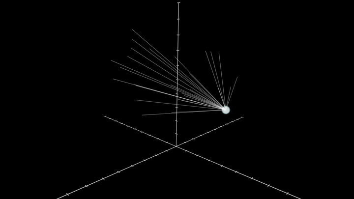

# Strange Attractors in ManimGL

Анимации аттракторов Лоренца и Айзавы, сделанные в [ManimGL](https://github.com/3b1b/manim).



## Что внутри

- `LorenzAttractor`: 10 траекторий с близкими начальными условиями, которые со временем расходятся (чувствительность к начальным данным).
- `AizawaAttractor`: 30 траекторий, медленное вращение и приближение камеры.

## Запуск

```bash
pip install manimgl
manimgl attractors.py LorenzAttractor
manimgl attractors.py AizawaAttractor -w   # запись видео
```

Для формул нужен LaTeX (в этих сценах он не используется, но понадобится для `Tex`).

## Как это устроено

Система ОДУ решается через `scipy.integrate.solve_ivp`, точки траектории
превращаются в `VMobject`, а `ShowCreation` рисует их по ходу времени.
Точки на концах кривых обновляются апдейтером.

## Credits

- Библиотека: [3b1b/manim](https://github.com/3b1b/manim) (MIT License)
- Сцена Лоренца 
- Аттрактор Айзавы

## License

MIT (см. файл `LICENSE`)